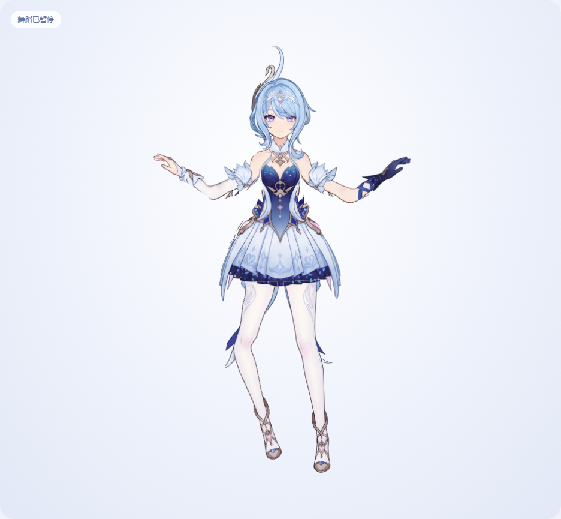

# 蓝发角色 · Live2D 手脚协调舞

基于人物三视图正面制作的 Live2D 模型，当前版本 **v08**。肩、肘、髋、膝可独立运动，附带 24 秒、120 BPM 的手脚协调舞。

## 功能

- 交替屈膝抬腿、对侧摆臂、双手展开、挥手和收势。
- 暂停、时间轴、循环、速度、幅度和可选本地节拍声。
- 眨眼、嘴型、转头、发梢摆动。
- 8192 × 8192 高清纹理，24 个参数、14 个可绘制网格。
- 原生动作、模型运行包、分层 PSD、CMO3 和重建配方。

## Windows 启动

需要 Python 3。观看预览不需要 Node.js。

1. 克隆或下载仓库。
2. 准备有权使用的官方 Cubism Core 5.1.0。先阅读并接受 [Live2D SDK 下载页](https://www.live2d.com/en/sdk/download/web/) 的相应许可。本仓库不自动接受协议或下载 Core。
3. 配置本机 Core：

~~~powershell
powershell -ExecutionPolicy Bypass -File .\delivery\Configure-Core.ps1 -CorePath "你的SDK目录\live2dcubismcore.min.js"
~~~

4. 双击 delivery/Open-Preview.bat，或运行：

~~~powershell
powershell -ExecutionPolicy Bypass -File .\delivery\Start-Preview.ps1
~~~

默认在本机 8881 端口打开预览并播放舞蹈；端口被其他服务占用时会使用后续空闲端口。仅监听 127.0.0.1。

已验证 Core 文件的[官方来源](https://cubism.live2d.com/sdk-web/core/05/live2dcubismcore.min.js)，版本 5.1.0，SHA-256：

~~~text
25ae938cb4fe282ce189b357bcc97e603d1e1f7ec78bf04150d401c23cdc792f
~~~

运行库搭配 Pixi 6.5.10 / pixi-live2d-display 0.4.0。不要直接替换为未经验证的 Core 版本。Core 文件由 Git 排除，原有本机文件保持可用。

其他系统配置相同 Core 后可运行：

~~~sh
python3 delivery/preview/server.py --port 8881
~~~

## 文件

| 路径 | 内容 |
| --- | --- |
| delivery/preview/ | 当前网页预览和舞蹈代码 |
| delivery/preview/model-v08/ | 模型、高清纹理、物理、原生舞蹈 |
| delivery/preview/downloads/model-v08.zip | 完整模型运行包 |
| source/editor/ | PSD、原分辨率和高清 CMO3 |
| source/revisions/ | 可移植分层、关节和 HD 配方 |
| source/source-inputs/ | 配方引用的原图和辅助素材 |
| source/toolchain/ | 导出适配器、锁定引擎信息和补丁 |
| references/、assets/ | 原始参考图和辅助绘制素材 |
| docs/validation-v08.json | 已完成验证的摘要 |

[源文件与重建说明](source/README.md)。PSD 是原始分辨率；高清 CMO3 的图层纹理由运行图集重建。

## 生成动作与验证

Node.js 20+：

~~~sh
npm install
npm run dance:build
~~~

舞蹈由 delivery/preview/dance.js 生成，20 条原生参数曲线，60 FPS。重新生成动作不会自动更新 ZIP；修改后需要重新验证、打包。

启动预览后运行：

~~~sh
npm run test:preview
~~~

默认使用 Windows 标准路径的 Chrome。可设置 CHROME_PATH 指定 Chrome，PREVIEW_URL 指定服务地址。验证输出保存在被 Git 忽略的 validation 目录。

已通过官方 Native Core 6.0.1 的 86 个姿势检查及 Web Core 5.1.0 实际播放检查。舞蹈 1,441 个参数采样均在范围内，三档幅度共 579 个真实网格姿势未出现肢体三角形翻折。暂停、收势、循环、节拍、手机布局和原生动作播放均经过检查。

验证仅覆盖交付动作及测试范围，未声称任意关节极限组合都安全。尚未在 VTube Studio 或官方编辑器实际运行。

## 依赖与素材

[第三方组件说明](THIRD_PARTY_NOTICES.md)。参考图与角色美术不因上传仓库而取得新的授权，本仓库不替素材权利人额外授予使用许可。
